# 🧬 Model Profiles, Providers & Stylometric Fingerprints

## 1. Provider Family Taxonomy

The 18 target models span **6 distinct model provider families**:

```mermaid
graph TD
    Root["18 Target LLMs"] --> Anthropic["Anthropic (5 models)"]
    Root --> Google["Google (4 models)"]
    Root --> OpenAI["OpenAI (5 models)"]
    Root --> ZAI["Zhipu AI (2 models)"]
    Root --> Moonshot["Moonshot AI (1 model)"]
    Root --> Alibaba["Alibaba (1 model)"]

    Anthropic --> A1["claude-fable-5"]
    Anthropic --> A2["claude-opus-4-6"]
    Anthropic --> A3["claude-opus-4-8"]
    Anthropic --> A4["claude-opus-5"]
    Anthropic --> A5["claude-sonnet-5"]

    Google --> G1["gemini-3.1-pro-preview"]
    Google --> G2["gemini-3.6-flash"]
    Google --> G3["gemini-3.7-flash"]
    Google --> G4["gemini-3.8-flash"]

    OpenAI --> O1["gpt-5.5"]
    OpenAI --> O2["gpt-5.6-luna"]
    OpenAI --> O3["gpt-5.6-sol"]
    OpenAI --> O4["gpt-5.6-terra"]
    OpenAI --> O5["gpt-6-astra"]

    ZAI --> Z1["glm-5.3"]
    ZAI --> Z2["glm-5.3-flash"]

    Moonshot --> M1["kimi-k3"]

    Alibaba --> Q1["qwen3.8-max"]
```

---

## 2. Quantitative Stylometric Fingerprints

Empirical analysis across the 150 prompt groups reveals consistent statistical traits:

| Feature | Highest Rate Model | Lowest Rate Model | Diagnostic Significance |
| :--- | :--- | :--- | :--- |
| **Em-dash (`—`) / 100 words** | Anthropic models (Claude) | Google models (Gemini) | Separates Claude family cleanly from Gemini/GLM |
| **Semicolon (`;`) / 100 words** | Claude Opus variants | Gemini Flash variants | High discriminator for deep prose vs fast models |
| **Curly quotes (`‘’“”`)** | Specific GPT & Claude models | GLM / Qwen models | Highlights markdown/rendering pipeline differences |
| **Colon (`:`) / 100 words** | Explanatory GPT variants | Poetic Claude variants | Reflects introductory phrasing style |
| **Parentheses `()` / 100 words** | GPT-5.6 variants | Gemini Flash variants | Parenthetical asides are common in GPT reasoning |
| **Uppercase Char Ratio** | Models capitalizing title terms | Models using lowercase conventions | Preserved when `lowercase=False` |
| **Average Word Length** | Academic/Research models | Conversational Flash models | Vocabulary complexity indicator |
| **Sentence Length Variation** | Anthropic Opus models | Flash/Turbo models | Measure of syntactic complexity |

---

## 3. Confusion Matrix Dynamics: The Two-Tier Problem

In 18-class classification, errors are **NOT uniformly distributed**. They concentrate heavily inside provider blocks:

### 1. Inter-Provider Distinction (Easier)
Distinguishing Claude from Gemini or GPT from GLM is relatively straightforward because macro-stylistic traits (em-dash usage, sentence rhythm, lexical diversity) differ substantially.

### 2. Intra-Provider Distinction (Hardest Challenge)
The vast majority of misclassifications occur **within the same provider family**:
- `gpt-5.6-sol` $\leftrightarrow$ `gpt-5.6-luna` $\leftrightarrow$ `gpt-5.6-terra`
- `gemini-3.6-flash` $\leftrightarrow$ `gemini-3.7-flash` $\leftrightarrow$ `gemini-3.8-flash`
- `claude-opus-4-6` $\leftrightarrow$ `claude-opus-4-8` $\leftrightarrow$ `claude-opus-5`
- `glm-5.3` $\leftrightarrow$ `glm-5.3-flash`

### Solution Strategy: Hierarchical / Cascaded Classification
1. **Tier 1 (Family Classifier)**: Predicts provider label (6 classes: `Anthropic`, `Google`, `OpenAI`, `ZAI`, `Moonshot`, `Alibaba`).
2. **Tier 2 (Intra-Family Specialists)**: Predicts the exact sub-model given the predicted provider family.
3. Combining global probability distributions with hierarchical priors prevents catastrophic confusion across different families.
